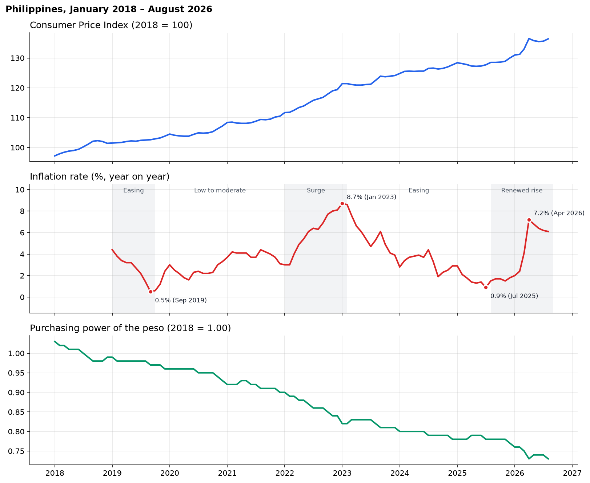
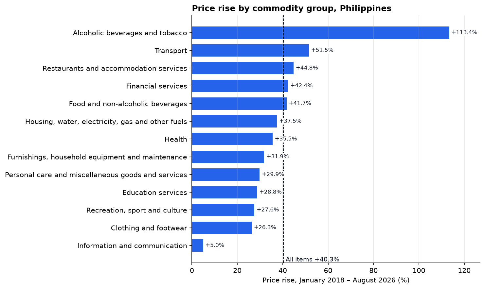
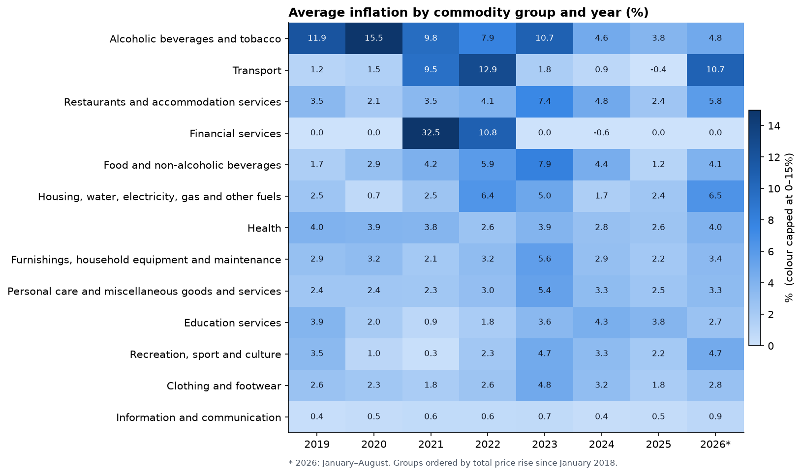
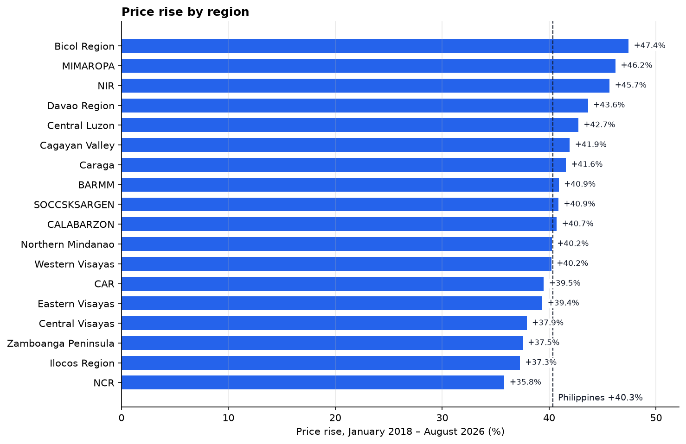
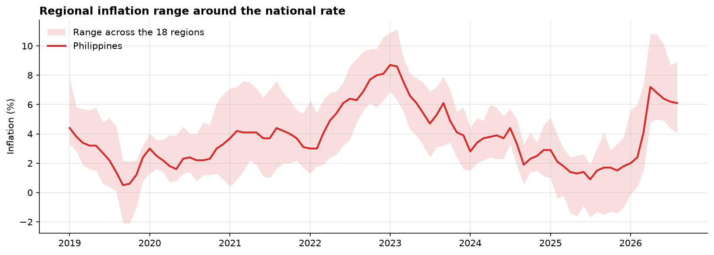
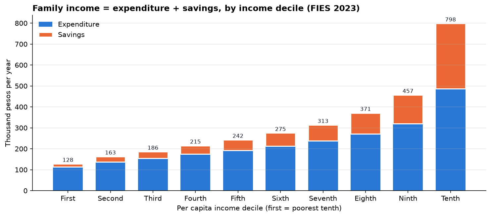
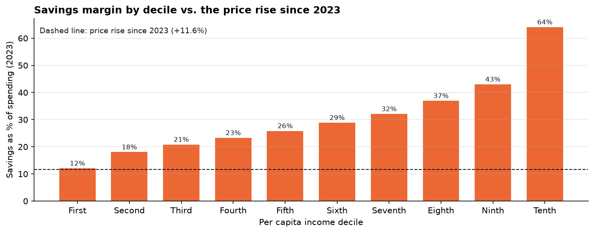

# PresyoPH – Historical Trends

*Member 2 (Data Scientist / Backend). Draft for team review.*

This document answers the proposal's second research question, "What are the historical trends in cost-of-living, inflation, and purchasing power in the Philippines?" (Specific Objective 2). It is written for the team and as source material for the paper. Every number comes from `notebooks/04_historical_trends.ipynb`, which reads the data through the same backend functions as the dashboard, so the report and the dashboard agree.

**In short:** prices rose **40.3%** between January 2018 and August 2026, and the peso now buys about **27% less** than in 2018. Inflation moved in five phases, peaking at **8.7%** in January 2023 and jumping again to **7.2%** in April 2026, led by transport. Alcohol and tobacco prices more than doubled (+113%). Price rises differed widely by region, from **+35.8% in NCR** to **+47.4% in Bicol**. For the poorest tenth of families, the price rise since 2023 (+11.6%) is about the size of their entire 2023 savings margin.

---

## 1. Scope and data

| Item | Value |
|---|---|
| CPI and purchasing power | January 2018 – August 2026 (104 months), 2018 = 100 |
| Inflation (year on year) | January 2019 – August 2026 (92 months) |
| Coverage | Philippines, 18 regions, 13 commodity groups |
| Household context | FIES 2023: average family income, expenditure, savings by region and income decile |
| Source | `presyoph_db`, built from the PSA OpenSTAT exports (see `data_preprocessing.md`) |

The analysis is **descriptive**: it reports what changed, when, where, and in which commodity groups. It does not explain why, which the data cannot show, and it does not estimate each group's contribution to overall inflation, which would need PSA's basket weights (section 8).

## 2. National trends



| Year | CPI, average | Inflation, average | Inflation, range | Purchasing power, last month |
|---|---|---|---|---|
| 2018 | 100.0 | – | – | 0.99 |
| 2019 | 102.4 | 2.4% | 0.5 – 4.4% | 0.96 |
| 2020 | 104.8 | 2.4% | 1.6 – 3.3% | 0.93 |
| 2021 | 108.9 | 3.9% | 3.1 – 4.4% | 0.90 |
| 2022 | 115.3 | 5.8% | 3.0 – 8.1% | 0.84 |
| 2023 | 122.2 | 6.0% | 3.9 – 8.7% | 0.81 |
| 2024 | 126.1 | 3.2% | 1.9 – 4.4% | 0.78 |
| 2025 | 128.2 | 1.7% | 0.9 – 2.9% | 0.77 |
| 2026 (Jan–Aug) | 134.4 | 5.2% | 2.0 – 7.2% | 0.73 |

CPI rose from 97.2 to 136.4 (**+40.3%**). Inflation averaged 3.8%; it was above 4% on average in 2022, 2023, and 2026.

**Five phases.** Inflation's turning points (its lows in September 2019 and July 2025, and its peak in January 2023) divide the period into five phases. This is a reading of the series, not an official PSA classification.

| Phase | Months | Start → end | Average | Highest |
|---|---|---|---|---|
| 1. Easing | Jan – Sep 2019 | 4.4% → 0.5% | 2.8% | 4.4% (Jan 2019) |
| 2. Low to moderate | Oct 2019 – Dec 2021 | 0.6% → 3.1% | 3.0% | 4.4% (Aug 2021) |
| 3. Surge | Jan 2022 – Jan 2023 | 3.0% → 8.7% | 6.0% | 8.7% (Jan 2023) |
| 4. Easing | Feb 2023 – Jul 2025 | 8.6% → 0.9% | 3.8% | 8.6% (Feb 2023) |
| 5. Renewed rise | Aug 2025 – Aug 2026 | 1.5% → 6.1% | 3.8% | 7.2% (Apr 2026) |

The renewed rise was abrupt: inflation went from 2.4% in February and 4.1% in March 2026 to **7.2% in April**, and stayed above 6% through August.

## 3. Purchasing power

PSA derives purchasing power from CPI (1 ÷ CPI × 100), so it falls as prices rise. Its value fell from 1.03 in January 2018 to **0.73** in August 2026: a peso now buys what ₱0.73 bought in 2018, about **27% less**. The largest one-year loss was in 2022 (−6.7%); the smallest in 2025 (−1.3%). In the first eight months of 2026 alone it lost 5.2%.

## 4. Commodity groups



- **Alcoholic beverages and tobacco rose the most by far, +113%**, more than double any other group. Its inflation was high throughout 2019–2023 (annual averages 7.9–15.5%).
- **Transport (+52%), restaurants and accommodation (+45%), financial services (+42%), and food (+42%)** rose faster than all items (+40%).
- **Information and communication barely changed (+5%)**, with inflation under 1% every year.
- Food tracked the overall rate closely (+41.7% against +40.3%).



**Which groups drove each phase.** During the 2022–2023 surge, transport ran hottest (12.7% average), followed by financial services (10.0%) and alcohol and tobacco (8.1%); housing and utilities (6.6%) and food (6.2%) were close to the overall 6.0%. Food inflation peaked a month after the overall peak (10.8% in February 2023).

**The April 2026 jump** was concentrated in a few groups:

| Group | Mar 2026 | Apr 2026 | Change |
|---|---|---|---|
| Transport | 9.9% | 21.4% | +11.5 points |
| Housing, water, electricity, gas and other fuels | 4.7% | 8.2% | +3.5 points |
| Food and non-alcoholic beverages | 2.9% | 6.0% | +3.1 points |
| All items | 4.1% | 7.2% | +3.1 points |

Every other group changed by about one point or less. Transport's 21.4% in April 2026 is the highest any group except financial services reached in the period. Financial services moves in rare, large steps (for example 43.3% in April 2021) and is 0% in most months, so its averages should be read with care.

## 5. Regions

Each region's CPI is indexed to its own 2018 level, so these figures compare **how fast prices rose**, not which region is more expensive.



| | Region | Price rise since Jan 2018 | Average inflation | Aug 2026 inflation |
|---|---|---|---|---|
| Highest | Bicol Region | +47.4% | 4.4% | 7.7% |
| | MIMAROPA | +46.2% | 4.4% | 5.4% |
| | Negros Island Region | +45.7% | 4.2% | 5.8% |
| | **Philippines** | **+40.3%** | **3.8%** | **6.1%** |
| | Zamboanga Peninsula | +37.5% | 3.5% | 7.6% |
| | Ilocos Region | +37.3% | 3.5% | 4.6% |
| Lowest | NCR | +35.8% | 3.4% | 4.1% |

- **NCR consistently had among the lowest inflation**, and so did Central Visayas: they were among the three lowest regions in 28 and 35 of 92 months respectively. **MIMAROPA and Bicol were most often among the three highest** (31 and 27 months).
- **In August 2026** the regions range from 4.1% (NCR) to 8.9% (Caraga and Davao Region); BARMM is at 8.8%.
- **Regions moved apart most in 2021 and 2026.** The average gap between the highest- and lowest-inflation region was 5.3 points in 2021 and 5.4 in 2026, against 2.9 in 2024. In September–November 2019 and in every month from February 2025 to January 2026, at least one region had falling prices (negative inflation) while the national rate stayed positive.



## 6. Household context (FIES 2023)

FIES is a single 2023 snapshot, so it cannot show trends; it is used here only to put the price changes in household terms.



- The average family earned ₱314,800 in 2023, spent ₱230,000, and saved ₱84,800 (27% of income).
- The richest tenth earned **6.2 times** as much as the poorest tenth (₱798,100 against ₱127,700) and saved 39% of income; the poorest tenth saved 11%.
- Among the poorest tenth, savings were thinnest in SOCCSKSARGEN (0.7% of income), Northern Mindanao (2.8%), NIR, and Caraga (both 4.2%). In 27 province-and-decile groups, average savings were negative (spending exceeded income), 15 of them in the first decile.

**Savings margin against the price rise since 2023.** Prices rose **11.6%** between the 2023 average and August 2026. The chart compares that with each decile's 2023 savings as a share of its spending. It is an illustration, not an estimate of current finances: it assumes incomes did not rise and families bought the same things.



For the **poorest tenth**, savings equal to 12% of spending is about the size of the price rise: without income growth, higher prices alone would have absorbed their whole savings margin. Every other decile had a margin of at least 18%.

Across the 18 regions, lower-income regions tended to see slightly larger price rises since 2018 (correlation r = −0.37), but this is a weak pattern on 18 data points.

## 7. Suggestions for the dashboard

For the screens still being built, the analysis suggests what to highlight:

- **Cost-of-Living Trends:** shade or label the five phases; call out the January 2023 peak and the April 2026 jump.
- **Commodity groups:** the cumulative price rise per group (figure 19) is the clearest single view; flag financial services' step-like behaviour.
- **Regional Comparison:** show the national rate alongside the regional range (figure 22), and note that regional indices compare price *growth*, not price levels.
- **Household Financial Overview:** the expenditure + savings = income bars by decile (figure 23) explain FIES at a glance.

## 8. Limitations

1. **Descriptive only.** The data shows when and where prices changed, not why. Causes such as tax or fuel-price changes need sources outside this dataset and are not claimed.
2. **No basket weights.** Groups are compared by their own price changes, not by how much each added to overall inflation.
3. **Phases are a reading of the series**, based on its turning points, not an official classification.
4. **Regional indices measure change, not price levels** (section 5).
5. **FIES is one year.** Section 6's savings-margin comparison is an illustration under stated assumptions.

## 9. Reproducing the results

With MySQL running and `presyoph_db` imported (see the README):

```
.venv/Scripts/python -m jupyter nbconvert --to notebook --execute --inplace notebooks/04_historical_trends.ipynb
```

This rewrites figures 18–24 in `reports/figures/`.
